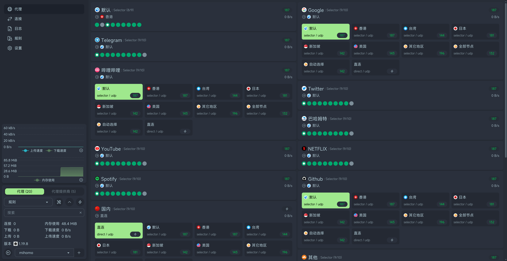
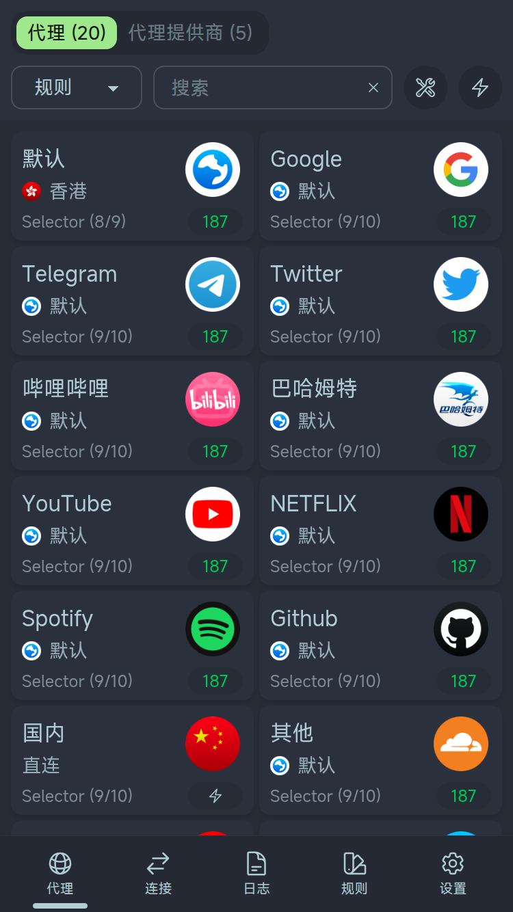

# NebulaDash

NebulaDash 是基于 [Zashboard](https://github.com/Zephyruso/zashboard) 的轻量增强分支，面向 OpenClash / Mihomo 日常使用场景优化。

核心目标：不引入常驻中转服务或数据库，浏览器直连后端，同时解决多 Provider 配置下代理页加载慢、搜索不稳定、规则链路难定位的问题。

<p align="center">
  
  
</p>

## 项目定位

- 上游来源：`Zephyruso/zashboard`
- 本仓地址：`boostemotion/nebuladash`
- 当前版本：`3.30.0-nebula.1`（基线 Zashboard `v3.30.0`）
- 技术栈：Vue 3 + Vite + TypeScript + Tailwind CSS / daisyUI
- 架构：纯前端面板，浏览器直连 OpenClash / Mihomo API

**代码形态**：以上游 v3.30.0 为基线，按清单重放本地增强，本地补丁约 2900 行。
因为与上游共享提交历史，上游跟进可以正常 `git merge upstream/main`。

NebulaDash 不是 Zashboard 官方版本。本分支会跟进上游更新，但会保留 OpenClash 多 Provider 环境下的本地优化。

## 主要增强

### 代理页三段视图

- 顶部三段：**策略组 / 节点组 / 代理商**，各自独立渲染，不再混排。
- 首屏只依赖 `/proxies`；只有切到“代理商”标签才请求 `/providers/proxies`。
- 每个标签独立记忆滚动位置。
- 列表沿用上游虚拟滚动，首屏只渲染视口附近的卡片。

### Provider 加载优化（核心）

OpenClash 在多 Provider 下 `/providers/proxies` 常需十几秒甚至超时，上游会与 `/proxies` 一起请求并拖死首屏。

- `/providers/proxies` 使用**独立 15 秒超时**。
- Provider 数据**按需加载**，不再随应用启动或进入代理页请求。
- 本地缓存按后端 UUID 隔离，可先用缓存起屏。
- 请求并发去重 + 代际校验，切换后端后过期响应直接丢弃。
- 失败/超时**保留旧缓存**，不清空页面，不抛未处理异常。
- 失败通知 60 秒去重，避免慢接口刷屏。
- 状态机 `idle / loading / fresh / cached / stale / timeout / error`，30 分钟内视为缓存数据、超过为旧缓存，界面上有状态徽标与耗时提示。

### 节点组聚类排序

- 同前缀簇自动相邻（例如 `香港-手动 / 香港-自动 / 香港-故转`）。
- 簇内顺序：`故转 > 手动 > 自动 > 负载均衡 > 其他`。
- 簇间优先“被策略组引用次数多”的簇，其次按基础名自然排序。
- 聚类词表可在代理页设置对话框内编辑（存储键 `config/node-cluster-variants`）。

### 搜索增强

在上游“分词 + 正则”搜索之上，补齐 NebulaDash 的语义：

- NFKC 规范化（全角字符可命中）
- 符号容错（`google-com` 命中 `google.com`）
- 域名 label 变体（`google.com` 命中只写 `google` 的规则/组）
- 多关键词 AND（空格 / 逗号 / 顿号分隔；`|` 仍按上游正则语义）
- **域名 → 规则 → 代理组反向映射**：代理页搜索 `google.com` 会显示相关规则指向的策略组与链路组
- **规则页链路感知**：搜索下游链路组名或最终出口节点名，能筛出上游规则
- 搜索高亮与匹配原因保持一致

### 规则直通

- 策略组卡片新增“规则直通”，打开链路弹窗查看完整链路。
- 链路末尾显示 `代理提供商: xxx`（取自节点自带 `provider-name`，未加载 Provider 时不显示、也不会触发请求）。
- 弹窗内“跳转规则”可直接切到规则页并带入当前组名。
- 规则卡片的链路同样显示代理商尾标。

### 更新保护与自管理更新器

- 面板更新源固定为 NebulaDash Release；后端 UI 下载地址不指向 NebulaDash Release ZIP 时，禁用“更新面板”，避免误装官方 Zashboard。
- 设置页可配置路由器端更新器：检查 / 更新 / 回滚。
- 更新前会检查 latest Release：远端更新直接继续；同版本、更旧或无法确认时需二次确认。
- 更新期间显示“下载 / 解压 / 切换分区”阶段。

### 构建与低资源设备

- 路由页面全部懒加载。
- `manualChunks` 拆包：`three` / `echarts` / `zrender` / `table` / `drag` / `icons` / `vue-vendor`。
- 入口 chunk 约 **88 kB**（上游原版约 2167 kB，PWA 预缓存 10.6 MB）。
- 保持纯前端架构，不增加路由器上的 Node / Docker 常驻负担。

## 下载

- [dist.zip](https://github.com/boostemotion/nebuladash/releases/latest/download/dist.zip)
- [router-updater.zip](https://github.com/boostemotion/nebuladash/releases/latest/download/router-updater.zip)
- 字体子集变体：`dist-no-fonts.zip`、`dist-cdn-fonts.zip`、`dist-firasans-only.zip`、`dist-misans-only.zip`、`dist-pingfang-only.zip`、`dist-sarasa-only.zip`

发布与公开仓库规则见 [PUBLICATION.md](./PUBLICATION.md)。

## OpenClash / Mihomo 更新配置

推荐把 UI 下载地址配置为 NebulaDash Release：

```yaml
external-ui-download-url: https://github.com/boostemotion/nebuladash/releases/latest/download/dist.zip
```

如果希望与原版 Zashboard 共存，使用不同的 `external-ui-name`：

```yaml
external-ui: /usr/share/openclash/ui
external-ui-name: nebuladash
```

示例访问地址：

```text
http://10.0.0.1:9090/ui/nebuladash/
```

## NebulaDash 自管理更新器

OpenClash LuCI 内置的 Dashboard / Yacd / Metacubed / Zashboard 按钮不包含 NebulaDash。若希望从面板按钮直接触发路由器更新，可安装可选的路由器端更新器：

- 源码目录：`router-updater/`
- 运行目录：`/usr/share/nebuladash-updater/`
- HTTP 入口：`/www/cgi-bin/nebuladash-updater`
- 面板入口：`/www/nebuladash`（软链到 `/www/nebuladash-a` 或 `-b`）
- 部署策略：A/B 分区，失败不切换，支持回滚

安装方式（路由器上直接拉取，无需手动上传）：

```sh
cd /tmp
wget -O router-updater.zip \
  https://github.com/boostemotion/nebuladash/releases/latest/download/router-updater.zip
unzip -oq router-updater.zip -d /tmp/nebula-updater
cd /tmp/nebula-updater/router-updater
sh install.sh
```

安装后会输出更新器 token，填到面板「设置 → 面板 → 路由器更新器 → 更新器密钥」。

安装和配置详见 [router-updater/README.md](./router-updater/README.md)。

## 连接参数

可通过 URL 参数预填后端连接信息：

```text
http://host:port/#/setup?hostname=ipordomain&port=9090&secret=123456
```

支持参数：`hostname`、`port`、`secret`、`secondaryPath`、`disableUpgradeCore`。

## 浏览器要求

- Chrome 111+
- Firefox 128+
- Safari 16.4+

## 使用提示

- 连接表格可用鼠标左键拖动，右键可复制单元格内容。
- 右键点击节点 / 节点组卡片可对节点 / 节点组测速。
- 节点组排序默认基于 GLOBAL 组；如需自定义顺序，可通过覆盖 GLOBAL 组指定。
- 支持 PWA，可在移动端通过“添加到主屏幕”获得类原生体验。

## 本地开发

本项目使用 `pnpm`（`packageManager: pnpm@10.15.0`），要求 Node.js 22+。

```bash
pnpm install
pnpm dev
```

常用命令：

```bash
pnpm test          # 单元测试（node:test）
pnpm type-check
pnpm lint
pnpm build
pnpm release:check # 发布前检查

# 需要本机 Chrome，或用 CHROME_BIN 指定
pnpm test:nebula   # NebulaDash 专属回归（三段视图 / Provider 按需加载 / 搜索 / 规则直通 / 更新源）
pnpm test:verify   # 上游虚拟滚动回归
pnpm test:bench    # 上游性能基准
```

Windows 下也可以使用启动脚本：

```powershell
.\start-za.ps1
.\start-za.ps1 -Check   # 仅检查环境
```

## 维护与上游同步

双远程模型：

- `upstream`：官方 Zashboard，只拉取
- `origin`：NebulaDash 自仓，只推送

资料入口：

- [upstream-followup/AI-HANDOFF.md](./upstream-followup/AI-HANDOFF.md)：新对话 / 其他 AI 接手入口
- [upstream-followup/NEBULADASH-FEATURE-INVENTORY.md](./upstream-followup/NEBULADASH-FEATURE-INVENTORY.md)：本地特色规格与取合表
- [upstream-followup/NEBULADASH-CHANGELOG.md](./upstream-followup/NEBULADASH-CHANGELOG.md)：维护更新日志
- [upstream-followup/REBASELINE-PLAN.md](./upstream-followup/REBASELINE-PLAN.md)：重基线方案与执行记录
- [README-改动说明.md](./README-改动说明.md)：相对上游的二改说明

同步原则：上游有的优先用上游；只在“上游没有且解决 OpenClash 痛点”的地方保留本地实现；每次改动写入维护日志。

## 验证基线

```bash
pnpm test
pnpm type-check
pnpm lint
pnpm build
pnpm test:nebula
```

## 致谢

- 原项目：[Zashboard](https://github.com/Zephyruso/zashboard)
- 后端生态：OpenClash、Mihomo / Clash.Meta、sing-box、dae

本项目继承上游 MIT License，保留上游版权与作者信息。
